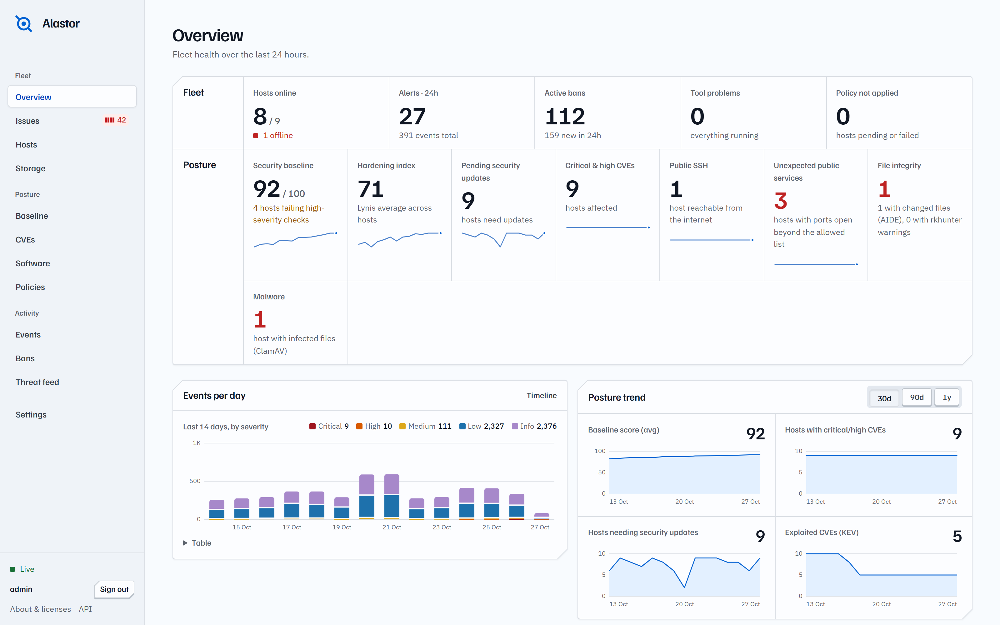
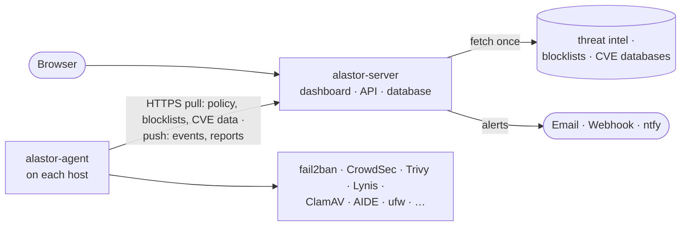

👁️

<p align="left">
  
</p>

# Alastor 🧙‍♂️

🪄 **Constant vigilance for your servers.** 🪄

A free, self-hosted security control plane for homelabs, VPSes and servers: one lightweight agent per machine, one
central server, one dashboard.

> Named after Alastor "Mad-Eye" Moody, the auror whose magical eye never stops watching. Alastor keeps an eye on
> every machine you run, so you don't have to SSH into each one to see what's going on. *Constant vigilance!*



More screenshots (hosts, issues, CVEs, bans, storage, …) are in [docs/screenshots](docs/screenshots).

## Why Alastor

Good open-source security tools already exist: fail2ban and CrowdSec ban attackers, Trivy and Grype find CVEs, Lynis
audits hardening, ClamAV, AIDE and rkhunter catch malware and tampering, ufw keeps the firewall tight. Each one is the
best at its job. The hard part is running ten of them, with ten config files and ten log formats, on every server you
own.

Alastor doesn't reinvent those wheels. It **bundles** them: the agent installs each tool from your distribution (or
adopts the one you already have), configures it from a single policy, and turns everything they report into one
dashboard and one alert stream. A one-stop shop for the security of your fleet, whether that's a Raspberry Pi in the
closet or fifty VPSes.

## What you get

- **Attackers kept out:** fail2ban or CrowdSec banning, public IP blocklists, a managed ufw firewall with SSH lockout
  guards.
- **Patches and CVEs:** pending security updates installed on a schedule, CVE scans of packages and containers,
  flagged when a CVE is actively exploited.
- **Hardening:** 21 baseline checks with one-click, reversible fixes, plus Lynis audits.
- **Exposure:** every listening service and whether the internet can reach it, with a warning for public SSH.
- **Malware and tampering:** ClamAV scans, rootkit checks and file integrity monitoring.
- **Who logged in:** an alert on a user's first SSH login from a new address.
- **Alerts that don't spam:** email, webhook or ntfy, deduplicated, with digests.
- **Housekeeping:** a software inventory across the fleet, disk usage and one-click cleanups.

All of it is configured from one layered policy (global → group → host) and shows up live in the dashboard.
See the [full feature list](docs/features.md).

## How it works



Agents only ever talk to your server. Threat intel, blocklists and vulnerability databases are fetched once by the
server and handed out, so your hosts need no other outbound access. More in [how it works](docs/how-it-works.md).

## Quick start

On the machine that will run the dashboard, as root:

```bash
# With Tailscale running: the dashboard is on your tailnet only. Without it: this machine only (SSH tunnel).
curl -fsSL https://raw.githubusercontent.com/nor0x/Alastor/main/install/install.sh | sudo bash -s -- --with-agent

# VPS with a domain pointing at it: HTTPS on the internet through Caddy
curl -fsSL https://raw.githubusercontent.com/nor0x/Alastor/main/install/install.sh | sudo bash -s -- --domain alastor.example.com --with-agent
```

It prints the dashboard URL and an admin password. To add a server, open **Settings → Enrollment → New token** and
run the command it shows on that server. `alastor status`, `sudo alastor stop` and `sudo alastor start` control it on
that machine, as does **Settings → Server** in the dashboard. Access modes, Docker, installing from a clone and
upgrades are covered in the [install guide](docs/install.md).

Runs on x86_64 and arm64 Linux with systemd (Debian, Ubuntu, RHEL/Alma/Rocky, Fedora). The server is
[secure by default](docs/security.md): loopback only, private and tailnet networks only, optional two-factor sign-in.

## Documentation

| | |
|---|---|
| [Features](docs/features.md) | everything Alastor does, area by area |
| [How it works](docs/how-it-works.md) | server, agents, the event stream and policy reconciliation |
| [Tools and data sources](docs/tools.md) | every bundled tool, what Alastor does with it, and its license |
| [Install](docs/install.md) | server, agents, Docker, upgrades and uninstall |
| [Configuration](docs/configuration.md) | server environment variables |
| [Security](docs/security.md) | how the server protects itself |
| [Development](docs/development.md) | repository layout, running locally, build and test |
| [Architecture](docs/architecture.md) | event model, integration interface, API and internals |

## License

MIT for Alastor's own code. Bundled tools are installed from your distribution and keep their own licenses, listed
in [docs/tools.md](docs/tools.md) and on the dashboard's About page.


👁️
