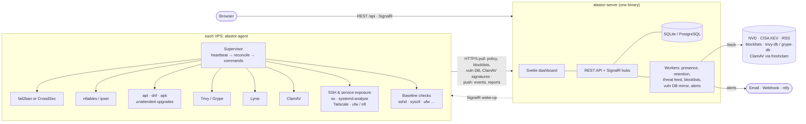
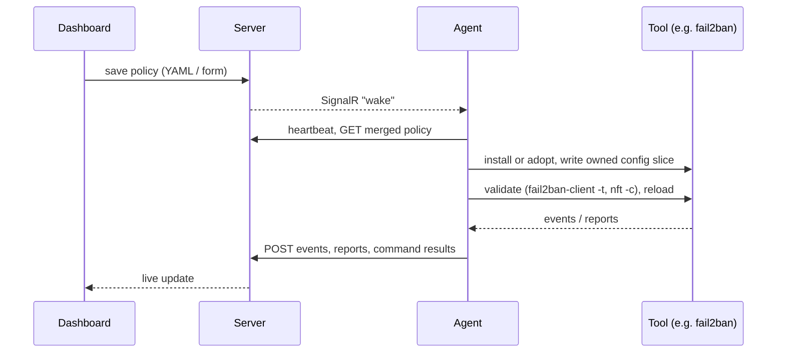

# Alastor

Free, self-hosted endpoint protection for Linux VPS fleets: one lightweight agent per server, one central
server, one dashboard. Alastor doesn't reinvent security engines. It **orchestrates** proven open-source
tools (fail2ban, CrowdSec, Trivy, Lynis, ClamAV, unattended-upgrades, …): it installs or adopts them, owns their
configuration declaratively, and turns their output into one normalized alert pipeline.

**Status:** all 10 deliverables are done. The server (REST API, SignalR, SQLite or PostgreSQL), the agent and the
Svelte dashboard cover:

- **Hosts:** overview and host detail with live metrics, a capability matrix, events, bans and commands.
- **Charts:** events per day by severity, ban activity per hour, a host × area posture matrix, and 30/90/365-day trends
  of baseline score, CVEs, exploited CVEs and pending updates from daily posture snapshots.
- **Banning:** fail2ban, or CrowdSec with its firewall bouncer (opt-in), managed from policy, with bans and allowlist
  in the dashboard.
- **Policy:** layered global → group → host, with form and YAML editors, live validation, schedule preview, version
  history and revert.
- **Security baseline:** 21 checks per host with one-click, reversible fixes.
- **Alerts:** email, webhook and ntfy channels, with dedup and digests.
- **Issues:** open problems per host (public SSH, exploited CVEs, malware, failing checks, tools down, …) that resolve on
  their own when fixed, with acknowledge and a badge in the navigation.
- **Blocklists:** public IP blocklists, merged by the server.
- **Security updates:** reported, installed now or on a schedule, with the services still running replaced code
  (needrestart / needs-restarting) and a kernel-reboot check.
- **SSH logins:** successful logins from the journal or auth.log, with an alert on a user's first login from a new
  address (Critical for root) and trusted sources that never alert.
- **CVE scans:** Trivy or Grype against a server-mirrored database, joined with CISA KEV, plus the images of running
  Docker/Podman containers (opt-in, local images only).
- **Firewall:** ufw managed from policy (opt-in, Debian/Ubuntu) with lockout guards for SSH.
- **Lynis audits:** hardening index and a remediation checklist.
- **Exposure:** warnings when SSH is reachable from the internet, an inventory of every listening service (owner,
  systemd unit, `systemd-analyze security` score, firewall verdict) with alerts for public ports outside
  `network.allowPublicPorts`, and Tailscale detection.
- **Malware scans:** ClamAV (opt-in) over web roots and upload directories, with signatures mirrored by the server.
- **File integrity and rootkits:** AIDE (opt-in) compares binaries, `/etc` and SSH keys with an accepted baseline;
  rkhunter (opt-in) checks for rootkits and changed binaries. Both report only, with accept actions in the dashboard.
- **Threat feed:** NVD, CISA KEV and security news.
- **Settings and About:** groups, enrollment tokens, API keys, audit log, and tool licenses.
- **Installers:** one-line installers for the server and the agent, and a Docker image with compose for the server.

Live updates use SignalR, with polling when the hub is unreachable.
See [docs/architecture.md](docs/architecture.md) for the event model, integration interface and API surface.

## How it works



Agents only ever talk to your server. Everything that comes from the internet (threat intel, IP blocklists,
vulnerability databases, ClamAV signatures) is fetched once by the server and handed to agents, so hosts need no outbound access
beyond it, apart from their distribution's package mirrors for installs and updates. CrowdSec's Central API (signal
sharing and its community blocklist) stays off unless you set `banning.crowdsecCentralApi: true`.

Every tool's output is normalized into one event stream that feeds the timeline, live dashboard and alerts:


Configuration flows the other way: you edit a layered policy (global → group → host) in the dashboard, and each
agent reconciles its host to match:



## Included tools

Alastor installs these from your distribution's repositories (or adopts an existing install) and never
vendors binaries. Trivy, Grype and Tailscale aren't packaged by most distributions, so the agent adopts them when
you install them from their vendor's repository (Alpine's `trivy` package is the exception it installs itself). `GET /api/about` and the dashboard's About page list the same set with licenses.

| Tool | Capability | What Alastor does with it | License | Status |
|---|---|---|---|---|
| [fail2ban](https://github.com/fail2ban/fail2ban) | Banning | writes `jail.d/alastor.local` from policy, validates, reloads, streams bans/unbans | GPL-2.0-or-later | ✅ |
| [nftables](https://netfilter.org/projects/nftables/) / ipset | Blocklists | loads merged public blocklists into its own `inet alastor` table (ipset + iptables fallback) | GPL-2.0 | ✅ |
| [unattended-upgrades](https://wiki.debian.org/UnattendedUpgrades), dnf, apk | Updates | counts pending security updates, installs them on schedule or on demand, flags required reboots | GPL-2.0 | ✅ |
| [needrestart](https://github.com/liske/needrestart), dnf `needs-restarting` | Updates | adopted, never installed: after each check lists services still running replaced libraries (`needrestart -b -r l`, list only) and a pending kernel | GPL-2.0 | ✅ |
| SSH login monitor (built in) | Access | reads sshd's `Accepted …` messages from the journal (or auth.log / secure); the server alerts on new (user, address) pairs | MIT | ✅ |
| [Trivy](https://github.com/aquasecurity/trivy) or [Grype](https://github.com/anchore/grype) | Vulnerabilities | offline CVE scans of OS and language packages against a server-mirrored database | Apache-2.0 | ✅ |
| [Lynis](https://cisofy.com/lynis/) | Hardening | scheduled audits; hardening index, warnings and suggestions as a checklist | GPL-3.0 | ✅ |
| Exposure inventory (built in) | Network | every listening service from `ss -tulpn` (iproute2), its systemd unit and `systemd-analyze security` score, judged against ufw/nft; flags public ports outside `network.allowPublicPorts` | MIT | ✅ |
| Security baseline (built in) | Hardening | 21 checks via `sshd -T`, `sysctl`, `ufw status`, `nft -j`, … with reversible one-click fixes | MIT | ✅ |
| [Caddy](https://caddyserver.com/) | Server TLS | optional, set up by `install.sh --domain` for automatic HTTPS | Apache-2.0 | ✅ |
| [CrowdSec](https://github.com/crowdsecurity/crowdsec) + firewall bouncer | Banning | `banning.engine: crowdsec`: installs both from distro repos, owns a parser whitelist for the allowlist, bans and events via `cscli … -o json`; Central API off by default | MIT | ✅ opt-in |
| [ufw](https://launchpad.net/ufw) | Firewall | `firewall.manage`: the agent keeps its own allow rules (tagged `alastor`: SSH from `firewall.ssh`, `network.allowPublicPorts`, `firewall.allow`), validated with `--dry-run`, rolled back on failure, refused when SSH could be locked out | GPL-3.0 | ✅ opt-in |
| [Tailscale](https://tailscale.com/) | Network | detected, never installed: tailnet state, IPs, Tailscale SSH, key expiry; SSH exposure check suggests limiting SSH to the tailnet | BSD-3-Clause | ✅ opt-in |
| [AIDE](https://aide.github.io/) | Integrity | `integrity.checkSchedule`: runs with the agent's own config and database; reports added, removed and changed system files against an accepted baseline; "accept changes" re-records it | GPL-2.0-or-later | ✅ opt-in |
| [rkhunter](https://rkhunter.sourceforge.net/) | Malware | `malware.rootkitSchedule`: `--check --rwo` after recording file properties; never updates from the internet; warnings ranked by severity, `rootkitIgnore` for known ones | GPL-2.0-or-later | ✅ opt-in |
| [ClamAV](https://www.clamav.net/) | Malware | `malware.scanSchedule`: niced `clamscan` of web roots and upload dirs, report only; signatures from the server's freshclam mirror (hosts never contact ClamAV's CDN) | GPL-2.0 | ✅ opt-in |

**Data sources the server fetches** (all free, no account needed):

| Source | Used for |
|---|---|
| [NVD](https://nvd.nist.gov/) CVE API 2.0 | threat feed (optional `ALASTOR_NVDAPIKEY` raises the rate limit) |
| [CISA KEV](https://www.cisa.gov/known-exploited-vulnerabilities-catalog) | threat feed; flags host CVEs that are actively exploited |
| The Hacker News, BleepingComputer, Krebs on Security, SecurityWeek, Dark Reading (RSS) | security news in the threat feed |
| [Spamhaus DROP](https://www.spamhaus.org/blocklists/do-not-route-or-peer/), [FireHOL level 1](https://iplists.firehol.org/?ipset=firehol_level1), [abuse.ch Feodo Tracker](https://feodotracker.abuse.ch/blocklist/), [Emerging Threats compromised](https://rules.emergingthreats.net/), [blocklist.de](https://www.blocklist.de/en/export.html), [CINS Army](https://cinsscore.com/#list) | IP blocklists, merged per host minus private ranges and your allowlist |
| `ghcr.io/aquasecurity/trivy-db:2`, Grype DB v6 | vulnerability databases mirrored for agents |
| ClamAV signatures (`database.clamav.net`, through `freshclam`) | malware scans; mirrored only once some host has a malware scan schedule |

**Main libraries:** ASP.NET Core, EF Core (SQLite, [Npgsql](https://www.npgsql.org/)), SignalR,
[Serilog](https://serilog.net/), [YamlDotNet](https://github.com/aaubry/YamlDotNet),
[Cronos](https://github.com/HangfireIO/Cronos), [MailKit](https://github.com/jstedfast/MailKit) on the backend;
[Svelte 5](https://svelte.dev/), [Vite](https://vite.dev/), `@microsoft/signalr` and [yaml](https://eemeli.org/yaml/) in the dashboard.

## Install

One command on the machine that runs the dashboard (a VPS, or any Linux box at home), as root:

```bash
# VPS with a domain pointing at it: HTTPS through Caddy, and protect this server too
curl -fsSL https://raw.githubusercontent.com/nor0x/Alastor/main/install/install.sh | sudo bash -s -- --domain alastor.example.com --with-agent

# local machine or LAN, plain HTTP on :8080
curl -fsSL https://raw.githubusercontent.com/nor0x/Alastor/main/install/install.sh | sudo bash
```

It prints the dashboard URL and a generated admin password. To add a server, open **Settings → Enrollment → New
token** in the dashboard and run the command it shows on that server. That command comes from your own Alastor
server, which also hands out the agent binary:

```bash
curl -fsSL https://alastor.example.com/install/agent.sh | sudo bash -s -- --server https://alastor.example.com --token sve_…
```

Run either script again to upgrade; settings, data and enrollment are kept. `--uninstall` removes the server or agent
(`--uninstall --purge` also deletes the server's database). `--help` lists all options. Supported: x86_64 and arm64 Linux with
systemd and glibc (Debian, Ubuntu, RHEL/Alma/Rocky, Fedora).

| Path | |
|---|---|
| `/opt/alastor/` | server binary, plus `agent/` with the agent binaries it serves |
| `/etc/alastor/server.env` | server settings (env vars below); `systemctl restart alastor-server` after editing |
| `/var/lib/alastor/` | database and keys |
| `/usr/local/bin/alastor-agent`, `/etc/alastor-agent/agent.json` | agent binary and enrollment |

**While the repository is private,** the script and the release binaries need a GitHub token with read access
(`gh auth token` prints yours):

```bash
export GITHUB_TOKEN=$(gh auth token)   # or a fine-grained PAT with Contents: read
curl -fsSL -H "Authorization: Bearer $GITHUB_TOKEN" https://raw.githubusercontent.com/nor0x/Alastor/main/install/install.sh \
  | sudo GITHUB_TOKEN="$GITHUB_TOKEN" bash
```

Agents need no token: they download the agent from your server. Binaries come from GitHub releases, built by
`.github/workflows/release.yml` when a `v*` tag is pushed. `ALASTOR_DOWNLOAD_BASE=https://…` makes both scripts download
`<base>/<version>/<asset>` instead, for a mirror or a future website.

**From a clone,** the script builds and installs that checkout instead of downloading a release (needs the .NET 10
SDK and Node.js 22+; clang and zlib1g-dev give a Native AOT agent, otherwise it builds a JIT one). The build runs as
the checkout's owner, into `artifacts/install/`. All options work the same, and `--version vX.Y.Z` installs that
release instead:

```bash
git clone https://github.com/nor0x/Alastor && cd Alastor
sudo ./install/install.sh --with-agent
```

Prebuilt binaries can also be passed in directly:
`sudo ./install/install.sh --binary path/to/alastor-server --agent-dir <dir with alastor-agent-linux-x64>`.

### Docker

The server also runs as a container. The image holds the dashboard, the agent binary it hands out to hosts (for the
image's architecture) and `freshclam` for the ClamAV mirror. Agents still run on each VPS under systemd: install them
with the command from **Settings → Enrollment**.

```bash
git clone https://github.com/nor0x/Alastor && cd Alastor
ALASTOR_ADMINPASSWORD='a long passphrase' ALASTOR_PUBLICURL=https://alastor.example.com docker compose up -d
```

Data lives in the `alastor-data` volume (`/data`). Put a reverse proxy with TLS in front of port 8080; for a quick
local try without TLS, also set `ALASTOR_SECURECOOKIES=false` and enroll agents with `--insecure`. For PostgreSQL:
`docker compose --profile postgres up -d` with `ALASTOR_DATABASEPROVIDER=postgres` and
`ALASTOR_CONNECTIONSTRING="Host=postgres;Database=alastor;Username=alastor;Password=…"`. `docker build
--build-arg WITH_AGENT=false .` skips the Native AOT agent build (hosts then download the agent from GitHub releases).

## Repository layout

```
src/Alastor.Core      domain: SecurityEvent, policy model, IToolIntegration, the tool integrations
                      (fail2ban, CrowdSec, baseline, blocklists, updates, vulnerabilities, Lynis, network, ClamAV),
                      platform seams
src/Alastor.Server    ASP.NET Core minimal API + SignalR + EF Core; serves the embedded SPA; single-file publish
src/Alastor.Agent     supervisor daemon (Native AOT); enroll | run | status | uninstall
src/alastor-web       Svelte 5 + Vite dashboard; builds into Alastor.Server/wwwroot
tests/Alastor.Tests   xUnit: parsers on captured tool output (Fixtures/, each folder documents its source),
                      reconciliation, policy, API end to end
policy/default.yaml   global default policy (embedded into the server)
install/              install.sh (server) and agent-install.sh, also served by the server at /install/{server,agent}.sh
Dockerfile, compose.yaml   server image (dashboard + agent binary + freshclam)
docs/                 architecture
```

## Development quickstart

Requirements: .NET 10 SDK. For a real agent: a Linux box with systemd and root.

```bash
# server on :8080, data in ./data (SQLite, WAL)
ALASTOR_DATADIR=./data ALASTOR_ADMINPASSWORD='change-me-please' ALASTOR_SECURECOOKIES=false \
  dotnet run --project src/Alastor.Server

# log in, create a single-use enrollment token
curl -c cj -X POST localhost:8080/api/auth/login -H 'content-type: application/json' \
  -d '{"username":"admin","password":"change-me-please"}'
curl -b cj -X POST localhost:8080/api/enrollment-tokens -H 'content-type: application/json' \
  -H 'X-Alastor-Request: 1' -d '{"note":"my vps"}'

# on the target host (root): enroll, then run
sudo ./alastor-agent enroll --server http://SERVER:8080 --token sve_... --insecure   # https:// in production
sudo ./alastor-agent run
```

Dashboard development: with the server running on :8080, `cd src/alastor-web && npm install && npm run dev`
serves the SPA with hot reload on :5173 and proxies `/api` and `/hubs` to the server. `npm run build` writes the
production bundle into `src/Alastor.Server/wwwroot` (Release builds of the server run it automatically).

The agent adopts an existing fail2ban, or installs it from the distro repos, writes
`/etc/fail2ban/jail.d/alastor.local` from the policy, validates it with `fail2ban-client -t`, reloads,
and starts streaming ban events.

## Configuration (server)

| Env var | Default | |
|---|---|---|
| `ALASTOR_DATADIR` | `./data` next to the binary | SQLite DB, JWT key, data-protection keys |
| `ALASTOR_ADMINUSER` / `ALASTOR_ADMINPASSWORD` | `admin` / generated (printed once) | first-run admin |
| `ALASTOR_DATABASEPROVIDER` | `sqlite` | or `postgres` with `ALASTOR_CONNECTIONSTRING` |
| `ALASTOR_PUBLICURL` | request host | used in generated install commands |
| `ALASTOR_AGENTDOWNLOADDIR` | `./agent` next to the binary | agent binaries served at `/install/agent/` to hosts being installed |
| `ALASTOR_HEARTBEATINTERVAL` | `60s` | default heartbeat; per-host override via `agent.heartbeatInterval` |
| `ALASTOR_RETENTIONRUNINTERVAL`, `…METRICRETENTION`, `…EVENTRETENTION`, … | `1h`, `7d`, `90d` | all server timings: see [docs/architecture.md](docs/architecture.md#timings-and-schedules) |
| `ALASTOR_SECURECOOKIES` | `true` | set `false` only for plain-HTTP local dev |
| `ALASTOR_BLOCKLISTSENABLED` / `ALASTOR_BLOCKLISTREFRESHINTERVAL` | `true` / `4h` | public IP blocklists the server pulls and merges per host (*Bans → Blocklists*) |
| `ALASTOR_VULNDBENABLED` / `ALASTOR_VULNDBREFRESHINTERVAL` | `true` / `12h` | mirror the Trivy/Grype databases for agents' CVE scans; `false` for air-gapped servers (place the files in `data/vulndb/`) |
| `ALASTOR_FRESHCLAMPATH` / `ALASTOR_CLAMAVMIRROR` | `freshclam` / `database.clamav.net` | ClamAV signature mirror for agents' malware scans (needs the `clamav-freshclam` package on the server; the Docker image has it). Also under `data/vulndb/clamav/` |
| `ALASTOR_TRIVYDBREPOSITORY` / `ALASTOR_GRYPEDBURL` | `ghcr.io/aquasecurity/trivy-db:2` / `https://grype.anchore.io/databases` | where the mirror pulls from (an internal registry or mirror) |
| `ALASTOR_ALERTDEDUPWINDOW` / `ALASTOR_ALERTBURST` | `1h` / `1` | alert dedup per host and event; channels (email, webhook, ntfy) are set up under *Settings → Notifications* |
| `ALASTOR_THREATFEEDENABLED` | `true` | fetch NVD, CISA KEV and security news RSS; `false` for air-gapped servers |
| `ALASTOR_THREATFEEDINTERVAL` / `ALASTOR_THREATFEEDRETENTION` | `20m` / `30d` | |
| `ALASTOR_NVDAPIKEY` | – | optional, free; raises NVD's rate limit tenfold |
| `ASPNETCORE_URLS` | `http://0.0.0.0:8080` | put Caddy/nginx with TLS in front |

## Build & test

```bash
dotnet test
dotnet publish src/Alastor.Server -c Release -r linux-x64 -o artifacts/server   # one file, SPA embedded
dotnet publish src/Alastor.Agent  -c Release -r linux-x64 -o artifacts/agent    # Native AOT (needs clang, zlib1g-dev)
dotnet publish src/Alastor.Agent  -c Release -r linux-x64 -p:AgentAot=false -o artifacts/agent-jit
```

## License

MIT for Alastor's own code. Bundled tools are installed from your distribution and keep their own
licenses; `GET /api/about` lists them.
