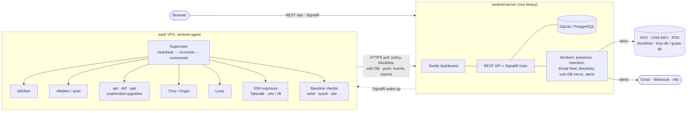
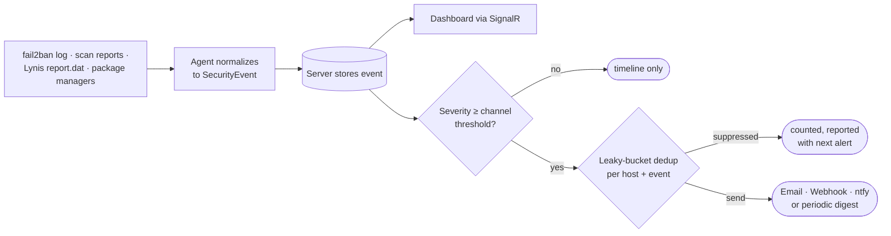
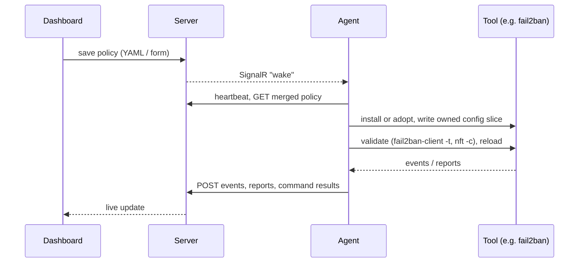

# SentinelVPS

Free, self-hosted endpoint protection for Linux VPS fleets: one lightweight agent per server, one central
server, one dashboard. SentinelVPS doesn't reinvent security engines. It **orchestrates** proven open-source
tools (fail2ban, CrowdSec, Trivy, Lynis, unattended-upgrades, …): it installs or adopts them, owns their
configuration declaratively, and turns their output into one normalized alert pipeline.

**Status:** deliverables 1–3 backend complete (server API, SQLite/PostgreSQL migrations, agent with heartbeat,
fail2ban integration end to end), threat feed (NVD CVEs, CISA KEV, security news), and the Svelte dashboard for
all of it: overview, hosts and host detail (live metrics, capability matrix, bans, events, commands), event
timeline, bans and allowlist, policy editor (form and YAML views with live validation, schedule preview, rendered
fail2ban config, version history and revert), security baseline (21 common hardening checks per host with
one-click, reversible fixes applied by the agent, accepted risks, and host-specific commands for manual fixes), alert
channels, blocklists, security updates, CVE scans (Trivy/Grype against a server-mirrored database, CISA KEV joined),
Lynis hardening audits (index, remediation checklist grouped by category, accepted items, fleet ranking), SSH exposure
warnings and Tailscale detection, threat feed, settings (groups, enrollment tokens, API keys, server
configuration, audit log) and About/licenses. Live updates over SignalR, with polling when the hub is unreachable.
See [docs/architecture.md](docs/architecture.md) for the event model, integration interface and API surface.

## How it works



Agents only ever talk to your server. Everything that comes from the internet (threat intel, IP blocklists,
vulnerability databases) is fetched once by the server and handed to agents, so hosts need no outbound access
beyond it.

Every tool's output is normalized into one event stream that feeds the timeline, live dashboard and alerts:



Configuration flows the other way: you edit a layered policy (global → group → host) in the dashboard, and each
agent reconciles its host to match:



## Included tools

SentinelVPS installs these from your distribution's repositories (or adopts an existing install) and never
vendors binaries. `GET /api/about` and the dashboard's About page list the same set with licenses.

| Tool | Capability | What SentinelVPS does with it | License | Status |
|---|---|---|---|---|
| [fail2ban](https://github.com/fail2ban/fail2ban) | Banning | writes `jail.d/sentinel-vps.local` from policy, validates, reloads, streams bans/unbans | GPL-2.0-or-later | ✅ |
| [nftables](https://netfilter.org/projects/nftables/) / ipset | Blocklists | loads merged public blocklists into its own `inet sentinel_vps` table (ipset + iptables fallback) | GPL-2.0 | ✅ |
| [unattended-upgrades](https://wiki.debian.org/UnattendedUpgrades), dnf, apk | Updates | counts pending security updates, installs them on schedule or on demand, flags required reboots | GPL-2.0 | ✅ |
| [Trivy](https://github.com/aquasecurity/trivy) or [Grype](https://github.com/anchore/grype) | Vulnerabilities | offline CVE scans of OS and language packages against a server-mirrored database | Apache-2.0 | ✅ |
| [Lynis](https://cisofy.com/lynis/) | Hardening | scheduled audits; hardening index, warnings and suggestions as a checklist | GPL-3.0 | ✅ |
| Security baseline (built in) | Hardening | 21 checks via `sshd -T`, `sysctl`, `ufw status`, `nft -j`, … with reversible one-click fixes | MIT | ✅ |
| [Caddy](https://caddyserver.com/) | Server TLS | optional, set up by `install.sh --domain` for automatic HTTPS | Apache-2.0 | ✅ |
| [CrowdSec](https://github.com/crowdsecurity/crowdsec) | Banning | collaborative behaviour-based banning, community blocklist, AppSec WAF | MIT | planned, opt-in |
| [ufw](https://launchpad.net/ufw) | Firewall | managed firewall rules | GPL-3.0 | planned |
| [Tailscale](https://tailscale.com/) | Network | detected, never installed: tailnet state, IPs, Tailscale SSH, key expiry; SSH exposure check suggests limiting SSH to the tailnet | BSD-3-Clause | ✅ opt-in |
| [ClamAV](https://www.clamav.net/) | Malware | scans of web roots and upload directories | GPL-2.0 | planned, opt-in |

**Data sources the server fetches** (all free, no account needed):

| Source | Used for |
|---|---|
| [NVD](https://nvd.nist.gov/) CVE API 2.0 | threat feed (optional `SENTINEL_NVDAPIKEY` raises the rate limit) |
| [CISA KEV](https://www.cisa.gov/known-exploited-vulnerabilities-catalog) | threat feed; flags host CVEs that are actively exploited |
| The Hacker News, BleepingComputer, Krebs on Security, SecurityWeek, Dark Reading (RSS) | security news in the threat feed |
| [Spamhaus DROP](https://www.spamhaus.org/blocklists/do-not-route-or-peer/), [FireHOL level 1](https://iplists.firehol.org/?ipset=firehol_level1), [abuse.ch Feodo Tracker](https://feodotracker.abuse.ch/blocklist/), [Emerging Threats compromised](https://rules.emergingthreats.net/), [blocklist.de](https://www.blocklist.de/en/export.html), [CINS Army](https://cinsscore.com/#list) | IP blocklists, merged per host minus private ranges and your allowlist |
| `ghcr.io/aquasecurity/trivy-db:2`, Grype DB v6 | vulnerability databases mirrored for agents |

**Main libraries:** ASP.NET Core, EF Core (SQLite, [Npgsql](https://www.npgsql.org/)), SignalR,
[Serilog](https://serilog.net/), [YamlDotNet](https://github.com/aaubry/YamlDotNet),
[Cronos](https://github.com/HangfireIO/Cronos), [MailKit](https://github.com/jstedfast/MailKit) on the backend;
[Svelte 5](https://svelte.dev/), [Vite](https://vite.dev/), `@microsoft/signalr` and [yaml](https://eemeli.org/yaml/) in the dashboard.

## Install

One command on the machine that runs the dashboard (a VPS, or any Linux box at home), as root:

```bash
# VPS with a domain pointing at it: HTTPS through Caddy, and protect this server too
curl -fsSL https://raw.githubusercontent.com/nor0x/DefBox/main/install/install.sh | sudo bash -s -- --domain sentinel.example.com --with-agent

# local machine or LAN, plain HTTP on :8080
curl -fsSL https://raw.githubusercontent.com/nor0x/DefBox/main/install/install.sh | sudo bash
```

It prints the dashboard URL and a generated admin password. To add a server, open **Settings → Enrollment → New
token** in the dashboard and run the command it shows on that server. That command comes from your own SentinelVPS
server, which also hands out the agent binary:

```bash
curl -fsSL https://sentinel.example.com/install/agent.sh | sudo bash -s -- --server https://sentinel.example.com --token sve_…
```

Run either script again to upgrade; settings, data and enrollment are kept. `--uninstall` removes the server or agent
(`--uninstall --purge` also deletes the server's database). `--help` lists all options. Supported: x86_64 and arm64 Linux with
systemd and glibc (Debian, Ubuntu, RHEL/Alma/Rocky, Fedora).

| Path | |
|---|---|
| `/opt/sentinel-vps/` | server binary, plus `agent/` with the agent binaries it serves |
| `/etc/sentinel-vps/server.env` | server settings (env vars below); `systemctl restart sentinel-server` after editing |
| `/var/lib/sentinel-vps/` | database and keys |
| `/usr/local/bin/sentinel-agent`, `/etc/sentinel-agent/agent.json` | agent binary and enrollment |

**While the repository is private,** the script and the release binaries need a GitHub token with read access
(`gh auth token` prints yours):

```bash
export GITHUB_TOKEN=$(gh auth token)   # or a fine-grained PAT with Contents: read
curl -fsSL -H "Authorization: Bearer $GITHUB_TOKEN" https://raw.githubusercontent.com/nor0x/DefBox/main/install/install.sh \
  | sudo GITHUB_TOKEN="$GITHUB_TOKEN" bash
```

Agents need no token: they download the agent from your server. Binaries come from GitHub releases, built by
`.github/workflows/release.yml` when a `v*` tag is pushed. `SENTINEL_DOWNLOAD_BASE=https://…` makes both scripts download
`<base>/<version>/<asset>` instead, for a mirror or a future website. Without a release, build the binaries yourself
(see [Build & test](#build--test)) and pass them in:
`sudo bash install/install.sh --binary artifacts/server/sentinel-server --agent-dir <dir with sentinel-agent-linux-x64>`.

## Repository layout

```
src/Sentinel.Core     domain: SecurityEvent, policy model, IToolIntegration, fail2ban integration, platform seams
src/Sentinel.Server   ASP.NET Core minimal API + SignalR + EF Core; serves the embedded SPA; single-file publish
src/Sentinel.Agent    supervisor daemon (Native AOT); enroll | run | status | uninstall
src/sentinel-web      Svelte 5 + Vite dashboard; builds into Sentinel.Server/wwwroot
tests/Sentinel.Tests  xUnit: parsers and normalization on real fail2ban fixtures, reconciliation, policy, API e2e
policy/default.yaml   global default policy (embedded into the server)
install/              install.sh (server) and agent-install.sh, also served by the server at /install/{server,agent}.sh
docs/                 architecture
```

## Development quickstart

Requirements: .NET 10 SDK. For a real agent: a Linux box with systemd and root.

```bash
# server on :8080, data in ./data (SQLite, WAL)
SENTINEL_DATADIR=./data SENTINEL_ADMINPASSWORD='change-me-please' SENTINEL_SECURECOOKIES=false \
  dotnet run --project src/Sentinel.Server

# log in, create a single-use enrollment token
curl -c cj -X POST localhost:8080/api/auth/login -H 'content-type: application/json' \
  -d '{"username":"admin","password":"change-me-please"}'
curl -b cj -X POST localhost:8080/api/enrollment-tokens -H 'content-type: application/json' \
  -H 'X-Sentinel-Request: 1' -d '{"note":"my vps"}'

# on the target host (root): enroll, then run
sudo ./sentinel-agent enroll --server http://SERVER:8080 --token sve_... --insecure   # https:// in production
sudo ./sentinel-agent run
```

Dashboard development: with the server running on :8080, `cd src/sentinel-web && npm install && npm run dev`
serves the SPA with hot reload on :5173 and proxies `/api` and `/hubs` to the server. `npm run build` writes the
production bundle into `src/Sentinel.Server/wwwroot` (Release builds of the server run it automatically).

The agent adopts an existing fail2ban, or installs it from the distro repos, writes
`/etc/fail2ban/jail.d/sentinel-vps.local` from the policy, validates it with `fail2ban-client -t`, reloads,
and starts streaming ban events.

## Configuration (server)

| Env var | Default | |
|---|---|---|
| `SENTINEL_DATADIR` | `./data` next to the binary | SQLite DB, JWT key, data-protection keys |
| `SENTINEL_ADMINUSER` / `SENTINEL_ADMINPASSWORD` | `admin` / generated (printed once) | first-run admin |
| `SENTINEL_DATABASEPROVIDER` | `sqlite` | or `postgres` with `SENTINEL_CONNECTIONSTRING` |
| `SENTINEL_PUBLICURL` | request host | used in generated install commands |
| `SENTINEL_AGENTDOWNLOADDIR` | `./agent` next to the binary | agent binaries served at `/install/agent/` to hosts being installed |
| `SENTINEL_HEARTBEATINTERVAL` | `60s` | default heartbeat; per-host override via `agent.heartbeatInterval` |
| `SENTINEL_RETENTIONRUNINTERVAL`, `…METRICRETENTION`, `…EVENTRETENTION`, … | `1h`, `7d`, `90d` | all server timings: see [docs/architecture.md](docs/architecture.md#timings-and-schedules) |
| `SENTINEL_SECURECOOKIES` | `true` | set `false` only for plain-HTTP local dev |
| `SENTINEL_BLOCKLISTSENABLED` / `SENTINEL_BLOCKLISTREFRESHINTERVAL` | `true` / `4h` | public IP blocklists the server pulls and merges per host (*Bans → Blocklists*) |
| `SENTINEL_VULNDBENABLED` / `SENTINEL_VULNDBREFRESHINTERVAL` | `true` / `12h` | mirror the Trivy/Grype databases for agents' CVE scans; `false` for air-gapped servers (place the files in `data/vulndb/`) |
| `SENTINEL_ALERTDEDUPWINDOW` / `SENTINEL_ALERTBURST` | `1h` / `1` | alert dedup per host and event; channels (email, webhook, ntfy) are set up under *Settings → Notifications* |
| `SENTINEL_THREATFEEDENABLED` | `true` | fetch NVD, CISA KEV and security news RSS; `false` for air-gapped servers |
| `SENTINEL_THREATFEEDINTERVAL` / `SENTINEL_THREATFEEDRETENTION` | `20m` / `30d` | |
| `SENTINEL_NVDAPIKEY` | – | optional, free; raises NVD's rate limit tenfold |
| `ASPNETCORE_URLS` | `http://0.0.0.0:8080` | put Caddy/nginx with TLS in front |

## Build & test

```bash
dotnet test
dotnet publish src/Sentinel.Server -c Release -r linux-x64 -o artifacts/server   # one file, SPA embedded
dotnet publish src/Sentinel.Agent  -c Release -r linux-x64 -o artifacts/agent    # Native AOT (needs clang, zlib1g-dev)
dotnet publish src/Sentinel.Agent  -c Release -r linux-x64 -p:AgentAot=false -o artifacts/agent-jit
```

## License

MIT for SentinelVPS's own code. Bundled tools are installed from your distribution and keep their own
licenses; `GET /api/about` lists them.
