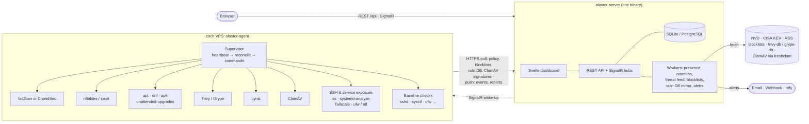
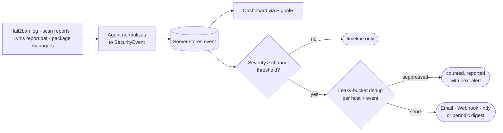
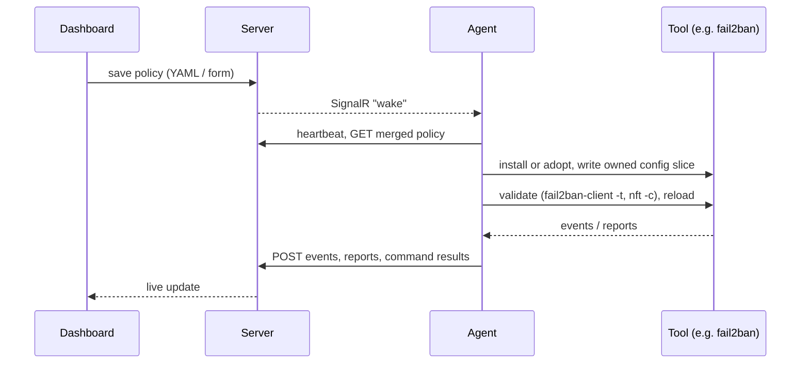

[← Alastor](../README.md) · How it works

# How it works

Alastor is one server (API, dashboard, database and background workers in a single binary) and one lightweight agent
per host. The agent installs or adopts the security tools on its host, configures them from your policy and reports
what they find.

## Agents only talk to your server

Everything that comes from the internet (threat intel, IP blocklists, vulnerability databases, ClamAV signatures) is
fetched once by the server and handed to agents, so hosts need no outbound access beyond it, apart from their
distribution's package mirrors for installs and updates. CrowdSec's Central API (signal sharing and its community
blocklist) stays off unless you set `banning.crowdsecCentralApi: true`.

## One event stream

Every tool's output is normalized into one event stream that feeds the timeline, live dashboard and alerts:

## Policy in, reconciled hosts out

Configuration flows the other way: you edit a layered policy (global → group → host) in the dashboard, and each
agent reconciles its host to match:

For example, the agent adopts an existing fail2ban, or installs it from the distro repos, writes
`/etc/fail2ban/jail.d/alastor.local` from the policy, validates it with `fail2ban-client -t`, reloads, and starts
streaming ban events.

The event model, integration interface and API surface are described in [architecture.md](architecture.md).
